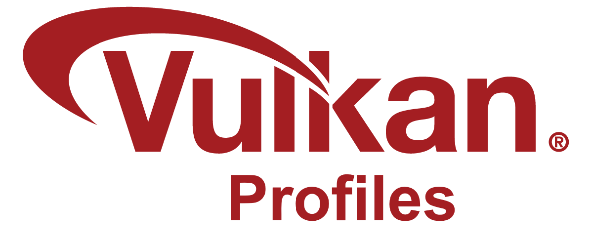
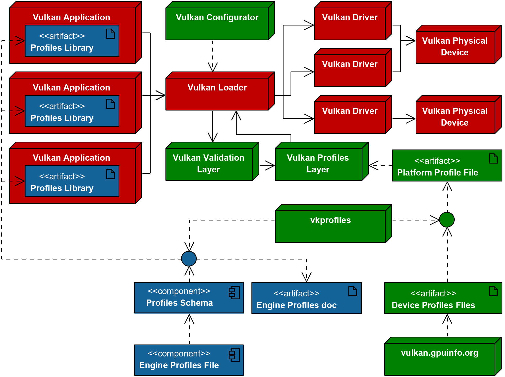
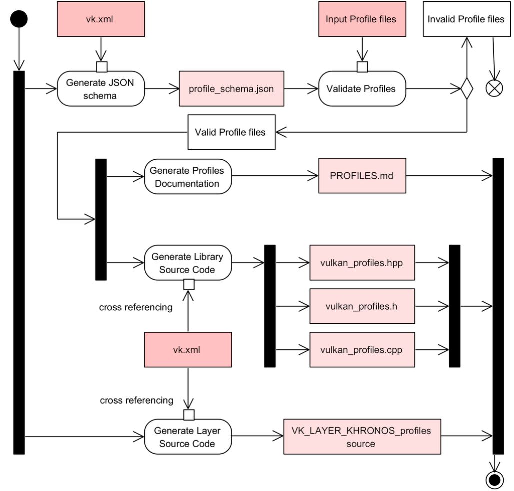
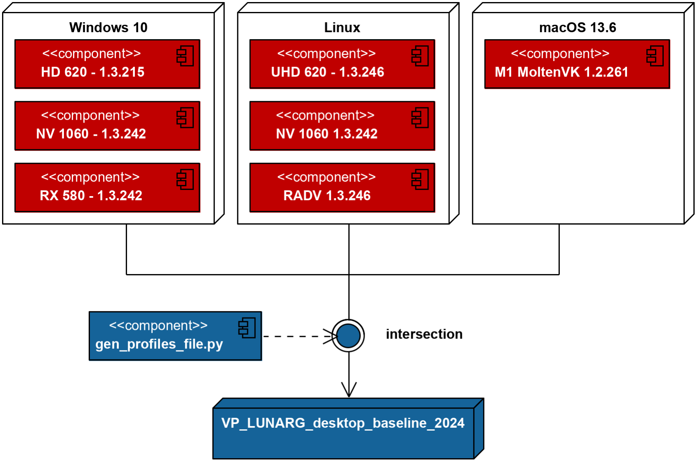
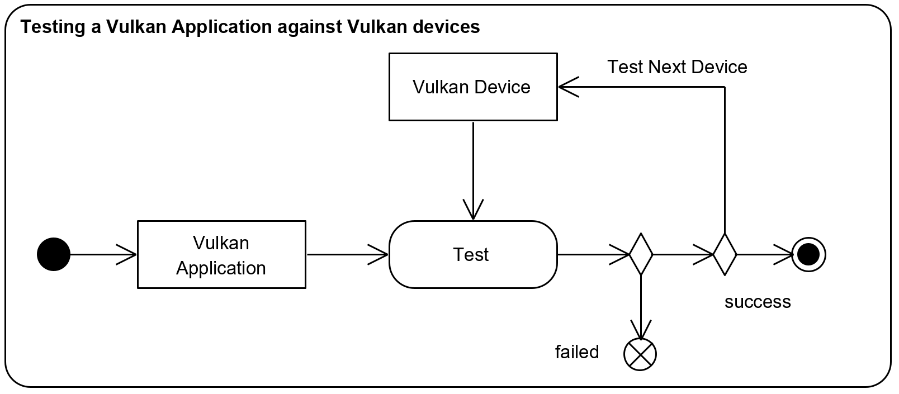
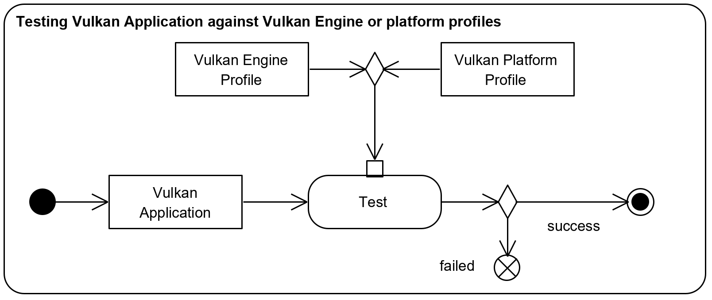
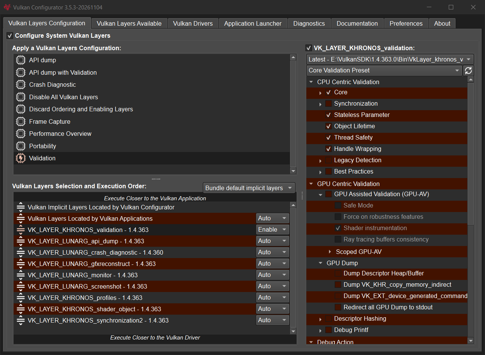
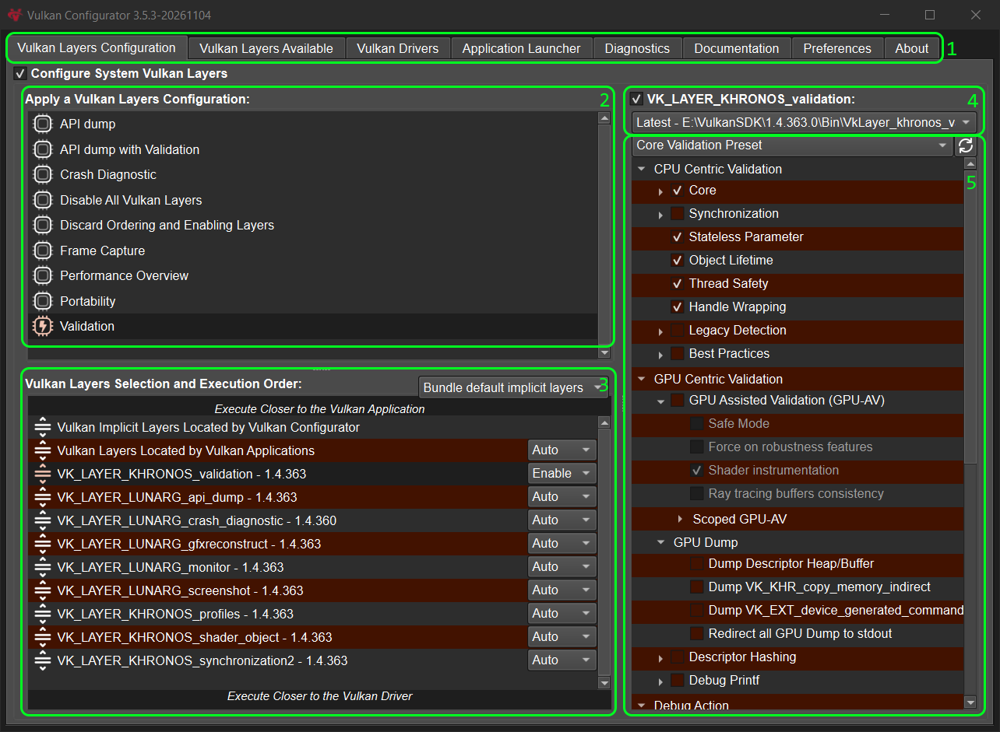
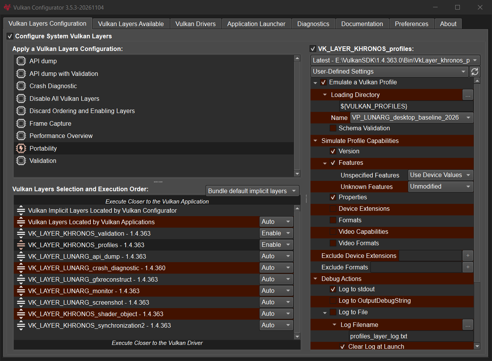
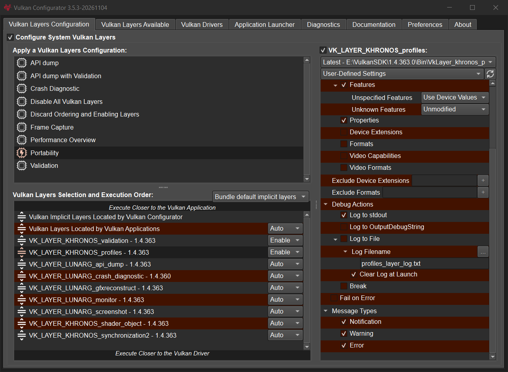

# The Vulkan Profiles Tools



**Better Vulkan Application Portability thanks to Vulkan Profiles**

Christophe Riccio, LunarG — November 2026

This whitepaper presents the Vulkan Profiles Tools and how they fit together. Each component is documented in detail in the [Vulkan Profiles repository](https://github.com/KhronosGroup/Vulkan-Profiles); see [Related documentation](#related-documentation) for the list of documents.

## Table of Contents

- [Why do Vulkan Profiles matter?](#why-do-vulkan-profiles-matter)
  - [Explicit Vulkan capability requirements](#explicit-vulkan-capability-requirements)
  - [Projects using Vulkan Profiles](#projects-using-vulkan-profiles)
  - [Different types of Vulkan Profiles](#different-types-of-vulkan-profiles)
- [The Vulkan Profiles Tools Components](#the-vulkan-profiles-tools-components)
  - [The vkprofiles command-line tool](#the-vkprofiles-command-line-tool)
  - [Vulkan Capability minimum requirements](#vulkan-capability-minimum-requirements)
  - [The Vulkan Profiles Tools Code Generation](#the-vulkan-profiles-tools-code-generation)
  - [The Vulkan Profiles documentation](#the-vulkan-profiles-documentation)
- [Creating a Vulkan Profiles JSON files](#creating-a-vulkan-profiles-json-files)
  - [Generating a Device Vulkan Profiles files](#generating-a-device-vulkan-profiles-files)
  - [Generating a Platform Vulkan Profiles JSON files](#generating-a-platform-vulkan-profiles-json-files)
  - [JSON script to generate merged Vulkan profiles](#json-script-to-generate-merged-vulkan-profiles)
  - [Creating a Vulkan Profiles JSON files manually](#creating-a-vulkan-profiles-json-files-manually)
  - [Identifying the minimum Vulkan API version of a profile](#identifying-the-minimum-vulkan-api-version-of-a-profile)
  - [Comparing engine profiles with platform profiles](#comparing-engine-profiles-with-platform-profiles)
  - [Limitations of Vulkan Profiles schema validation](#limitations-of-vulkan-profiles-schema-validation)
  - [Human readable Vulkan Profiles documentation](#human-readable-vulkan-profiles-documentation)
- [Using the Vulkan Profiles layer](#using-the-vulkan-profiles-layer)
  - [Simulation vs. Emulation](#simulation-vs-emulation)
  - [Reducing Vulkan application development time](#reducing-vulkan-application-development-time)
  - [Enabling the Profiles layer using Vulkan Configurator](#enabling-the-profiles-layer-using-vulkan-configurator)
  - [Vulkan Profiles layer limitations](#vulkan-profiles-layer-limitations)
- [Using the Vulkan Profiles API library](#using-the-vulkan-profiles-api-library)
  - [Integration of the Vulkan Profiles API library in an application](#integration-of-the-vulkan-profiles-api-library-in-an-application)
  - [Generating Vulkan Profiles API library](#generating-vulkan-profiles-api-library)
  - [Basic usage of the Vulkan Profiles API library](#basic-usage-of-the-vulkan-profiles-api-library)
  - [Advanced usage of the Vulkan Profiles library](#advanced-usage-of-the-vulkan-profiles-library)
- [Vulkan Profiles Tools future improvements](#vulkan-profiles-tools-future-improvements)
- [Related documentation](#related-documentation)
- [Revision History](#revision-history)
- [TODO](#todo)

## Why do Vulkan Profiles matter?

The discussion regarding shipping a cross-platform application is typically framed around a perfectly homogenous ecosystem against an overly heterogeneous ecosystem. The Vulkan ecosystem contains a huge diversity of hardware vendors, devices, and drivers that keep evolving, making it hard to be sure that any given Vulkan application will work on all targeted devices.

We believe at LunarG that expecting the ecosystem to be homogenous is unrealistic. This problem is not new and was also massive in the OpenGL/OpenGL ES ecosystem. Vulkan is a cross-platform and evolving industry standard enabling developers to target a wide range of devices with the same graphics API.

Instead, Vulkan Profiles look at the problem with a different paradigm: a Vulkan application is not designed to target the entire ecosystem, but has a domain of relevance. The different actors in the ecosystem should instead better communicate (including programmatically) about Vulkan support and Vulkan requirements. This is formalized by Vulkan Profiles.

### Explicit Vulkan capability requirements

The Vulkan Profiles make the Vulkan capability requirements explicit between the application and the domain of relevance of the Vulkan application. We should expect a co-evolution of the application and its domain, which can be formalized by profiles and revisions of the profiles.

Conceptually, Vulkan Profiles can be understood as the explicit expression and formalization of Vulkan capability requirements, which provide clear communication of these requirements within the Vulkan community and across Vulkan components in the ecosystem.

With this approach, we think Vulkan Profiles help create more portable Vulkan applications within a specific Vulkan domain; but we acknowledge Vulkan Profiles are as relevant as their adoption by the Vulkan ecosystem.

### Projects using Vulkan Profiles

We are interested in knowing how Vulkan developers are using Vulkan Profiles. Contact us to let us know!

#### Unreal Engine: A real-time 3D creation tool

The Unreal Engine uses the Android and Desktop profiles to specify the feature requirements of some rendering code paths. Specifically, it's used to check the support of the required Ray Tracing capabilities in the user's system. The code base uses the Vulkan Profiles API library to exit gracefully if the requirements are not satisfied. During the engine development process, the required Vulkan capabilities are gathered when the execution hits an assert. The validation layer checks for capability requirements scattered across the code, and these are then consolidated into profiles. When the application user starts an execution, the capability requirements are fully checked with the profile, ensuring they will not hit those asserts of missing capabilities.

#### DXVK: A Vulkan-based translation layer for Direct3D 9/10/11

This is a Vulkan-based translation layer for Direct3D 9/10/11 which allows running Direct3D applications on Linux using Wine.

The `VP_DXVK_requirements` profiles are used to list all the Vulkan capabilities required by the device's Vulkan driver to be able to run Direct3D 9, Direct3D 10.1 and Direct3D 11 for most relevant feature levels. For example, the `VP_DXVK_d3d11_level_11_1_baseline` profile lists the requirements to be able to run a Direct3D 11 Feature Level 11.1 application. The `VP_DXVK_d3d11_level_11_1_optimal` profile is similar to the `VP_DXVK_d3d11_level_11_1_baseline` but also includes Vulkan capabilities to get the best performance possible from the DXVK Direct3D 11 implementation.

#### vkd3d-proton: An implementation of the full Direct3D 12 API on top of Vulkan

vkd3d-proton is a fork of VKD3D, which aims to implement the full Direct3D 12 API on top of Vulkan. The project serves as the development effort for Direct3D 12 support in Proton.

The VKD3D profiles are used to list all the Vulkan capabilities required by the device's Vulkan driver to be able to run Direct3D 12 for most relevant feature levels. For example, the `VP_D3D12_FL_12_2_baseline` profile lists the requirements to be able to run a Direct3D 12 Feature Level 12.2 application. The `VP_D3D12_FL_12_2_optimal` profile is similar to the `VP_D3D12_FL_12_2_baseline` but also includes Vulkan capabilities to get the best performance possible from VKD3D-Proton Direct3D 12 implementation. VKD3D-Proton also has per-vendor dedicated profiles such as `VP_D3D12_maximum_radv` and `VP_D3D12_maximum_nv` which represent the maximum feature set VKD3D-Proton can use on RADV and NVIDIA driver, respectively.

#### Zink: a Gallium driver that emits Vulkan API calls

The Zink driver is a Gallium driver that emits Vulkan API calls instead of targeting a specific GPU architecture. This can be used to get full desktop OpenGL support on devices that only support Vulkan.

The `VP_ZINK_requirements` profiles are used to list all the Vulkan capabilities required by the device Vulkan driver to be able to run each version of OpenGL. For example, the `VP_ZINK_gl46_baseline` profile lists the requirements to be able to run an OpenGL 4.6 application. The `VP_ZINK_gl46_optimal` profile is similar to the `VP_ZINK_gl46_baseline` but also includes Vulkan capabilities to get the best performance possible from the Zink OpenGL implementation.

#### Android Baseline Profiles

The Android Baseline profiles addressed the challenge of determining what functionality Vulkan developers can rely on being present in Android devices. From sets of Vulkan extensions, features, formats, and limits that were found on the vast majority of active Android devices in 2021 and 2022, the Android Baseline 2021 and the Android Baseline 2022 profiles were created. These profiles can be used to filter the Android Vulkan applications on the Google Play store for devices not supporting the capabilities of these profiles.

#### Android 15 Minimums Profile

A collection of functionality that is mandated for chipsets that launch (or renew Google Requirements Freeze) on Android 15. This is effectively an Android Roadmap profile.

#### Khronos Roadmap Profiles

The Khronos Roadmap profiles are milestones referenced by all Vulkan Working Group hardware vendors actively developing mid-to-high-end devices for smartphone, tablet, laptop, console, and desktop platforms. These vendors have committed to supporting this milestone, starting with several shipping products in 2022.

### Different types of Vulkan Profiles

Vulkan Profiles can be applied for a multitude of use cases, including:

- **Roadmap profiles**: to express guidance on the future direction of Vulkan devices.
- **Platform profiles**: to express the Vulkan support available on different platforms.
- **Device profiles**: to express the Vulkan support of a single Vulkan driver on a Vulkan device.
- **Architecture profiles**: to express the Vulkan support of a class of GPUs.
- **Engine profiles**: to express some rendering code paths requirements of an engine.
- **Drivers bugs profiles**: to express capabilities that can't be used by an application.
- Etc.

## The Vulkan Profiles Tools Components

LunarG provides the Vulkan Profiles Tools as part of the Vulkan SDK so that Vulkan application developers may leverage Vulkan Profiles during Vulkan application development and delivery. Developers can create portable Vulkan applications in terms of Vulkan capabilities, which include extensions, features, properties, formats, and queue properties.

Of course, the Vulkan Profiles only handle portability in terms of Vulkan capabilities, but Vulkan profiles may be used to document known bugs in Vulkan drivers.

The Vulkan Profiles Tools include the following components:

- **The Vulkan Profiles schema**
  - A JSON data format to exchange Vulkan capabilities: extensions, features, properties, formats, and queue properties.
  - Each revision of Vulkan API is represented by a schema that supersedes older versions of Vulkan API.
  - The schema is generated from `vk.xml`: it covers the Vulkan API version and all the extensions of the Vulkan Headers it's generated from, Vulkan 1.4 with the current Vulkan Headers.
  - Documentation: [The Vulkan Profiles JSON Schema](https://github.com/KhronosGroup/Vulkan-Profiles/blob/main/OVERVIEW.md#the-vulkan-profiles-json-schema) and [Vulkan Profiles Files](https://github.com/KhronosGroup/Vulkan-Profiles/blob/main/OVERVIEW.md#vulkan-profiles-files) in `OVERVIEW.md`.
- **The `vkprofiles` command-line tool**
  - A standalone executable, shipped with the Vulkan SDK since SDK 1.4.363, which bundles the Vulkan Profiles generation scripts so no Python installation is required.
  - It combines multiple Vulkan Profiles into a single Vulkan Profile using an intersection, union or difference operation on the Vulkan capabilities listed by the source Vulkan Profiles (`vkprofiles combine`).
  - It validates Vulkan Profiles files against the Vulkan Profiles schema and analyses their semantics (`vkprofiles validate`), and generates the Vulkan Profiles API library (`vkprofiles library`) and the Vulkan Profiles documentation (`vkprofiles doc`).
  - It replaces the `gen_profiles_file.py` and `gen_profiles_solution.py` Python scripts, deprecated in Vulkan SDK 1.4.363 and removed in the December 2026 Vulkan SDK.
  - Documentation: [`scripts/README.md`](https://github.com/KhronosGroup/Vulkan-Profiles/blob/main/scripts/README.md).
- **The Vulkan Profiles layer**
  - A layer used during application development to ensure adherence to the requirements of a chosen Vulkan Profile.
  - It simulates but doesn't emulate Vulkan capabilities. It works together with the Validation layer which reports errors when using capabilities not exposed by the Vulkan developer system.
  - The layer requires a Vulkan 1.1 driver.
  - Documentation: [`layer/TUTORIAL.md`](https://github.com/KhronosGroup/Vulkan-Profiles/blob/main/layer/TUTORIAL.md).
- **The Vulkan Profiles library**
  - A header-only, C++ library to use Vulkan Profiles in Vulkan applications.
  - The library allows checking Profiles support on a device and creating a `VkDevice` and `VkInstance` instances with the profile features and extensions enabled.
  - The library requires a Vulkan 1.1 driver. Supporting Vulkan 1.0 drivers with the `VK_KHR_get_physical_device_properties2` extension is deprecated since Vulkan SDK 1.4.363.
  - A Vulkan sample is available for demonstrating Vulkan Profiles library usage.
  - Documentation: [`library/TUTORIAL.md`](https://github.com/KhronosGroup/Vulkan-Profiles/blob/main/library/TUTORIAL.md).
- **The Vulkan Profiles comparison table**
  - Human-readable format of Vulkan Profiles in a table to simplify comparison.
  - Documentation: see [The Vulkan Profiles documentation](#the-vulkan-profiles-documentation).

Furthermore, the Vulkan Profiles Tools install implementations of some Vulkan Profiles using the Vulkan Profiles JSON Schema. These files are installed in the configuration directory of the Vulkan Profiles layer (`Config/VK_LAYER_KHRONOS_profiles` on Windows, `share/vulkan/config/VK_LAYER_KHRONOS_profiles` on other platforms), so they are directly available to the layer:

| Vulkan Profiles file | Vulkan Profiles |
|----------------------|-----------------|
| `VP_KHR_roadmap.json` | `VP_KHR_roadmap_2022`, `VP_KHR_roadmap_2024`, `VP_KHR_roadmap_2026` |
| `VP_LUNARG_minimum_requirements.json` | `VP_LUNARG_minimum_requirements_1_0` to `VP_LUNARG_minimum_requirements_1_4` |
| `VP_LUNARG_desktop_baseline.json` | `VP_LUNARG_desktop_baseline_2022`, `VP_LUNARG_desktop_baseline_2023`, `VP_LUNARG_desktop_baseline_2024`, `VP_LUNARG_desktop_baseline_2026` |
| `VP_ANDROID_vulkan_profile_2021.json` | `VP_ANDROID_vulkan_profile_2021` |
| `VP_ANDROID_vulkan_profile_2022.json` | `VP_ANDROID_vulkan_profile_2022` |
| `VP_ANDROID_vulkan_profile_2025.json` | `VP_ANDROID_vulkan_profile_2025` |

`VP_KHR_roadmap.json` comes from the Vulkan Headers; the other files are generated when building the Vulkan Profiles Tools. Android rebranded the `VP_ANDROID_baseline_2021` and `VP_ANDROID_baseline_2022` profiles as `VP_ANDROID_vulkan_profile_2021` and `VP_ANDROID_vulkan_profile_2022`. The Android requirements profiles, `VP_ANDROID_15_requirements` to `VP_ANDROID_18_requirements`, are not installed, but they are available in the `profiles/Android` directory of the Vulkan Profiles repository and in the Vulkan Profiles API library.

The current list of Vulkan Profiles shipped with the Vulkan SDK is maintained in [Vulkan Profiles Files](https://github.com/KhronosGroup/Vulkan-Profiles/blob/main/OVERVIEW.md#vulkan-profiles-files) in `OVERVIEW.md`.

These Vulkan Profiles JSON files are written against the Vulkan Profiles JSON schema. There is a Vulkan Profiles JSON schema file per Vulkan Header version. The Vulkan SDK contains the Vulkan Profiles JSON schema corresponding to the Vulkan Header version of that Vulkan SDK. The Vulkan Profiles JSON schema is located in the `share/vulkan/registry` directory of the Vulkan SDK. All the schema can easily be downloaded by cloning the Khronos-Schema repository.

The Vulkan Profiles API is not part of the Vulkan specification, but part of a library, for a very specific reason: we wanted the Vulkan Profiles solution to be effectively usable on day one. Hence, it should work with current Vulkan devices currently owned by users.

The solution to this problem is to not deliver the Vulkan Profiles API through the Vulkan drivers (that can't be updated easily on many platforms), but to deliver the Vulkan Profiles API as part of the Vulkan application codebase.

As a result, the Vulkan Profiles library is compatible with any Vulkan 1.1 driver and can be leveraged simply by including it in the Vulkan application codebase.



*A typical setup of the Vulkan Profiles Tools components on the Vulkan developer system*

**Vulkan application side:**

- The Vulkan applications are built with the Vulkan Profiles API library.
- The Vulkan Profiles API library is generated using the `vkprofiles library` command and the Engine Profiles file.
- The Engine Profiles JSON file is written by the Vulkan application developers based on the actual rendering code paths Vulkan capabilities requirements.
- The Engine Profiles JSON file is written and validated against a Vulkan Profiles schema.
- The Engine Profiles Definition doc is a markdown file generated using the `vkprofiles doc` command.

**Vulkan development environment side:**

- The Vulkan Validation layer and the Vulkan Profiles layer are set up using the *Portability* built-in configuration in Vulkan Configurator.
- The Vulkan Profiles layer is configured so that the system simulates the Vulkan capabilities listed in the Platform Profile file.
- The Platform Profile file is generated using the `vkprofiles combine` command and Device Profiles files.
- The Device Profiles files are selected and downloaded from GPUInfo.org. The criteria for the Device Profiles files depends on the developers of the Vulkan application and the device ecosystem they want to reach for typically technical and economical reasons.

### The vkprofiles command-line tool

Since SDK 1.4.363, the Vulkan SDK ships `vkprofiles`, a standalone executable installed alongside the other Vulkan SDK tools. It bundles the Vulkan Profiles generation code, so Vulkan developers no longer need a Python installation to create Vulkan Profiles files, generate the Vulkan Profiles API library or generate the Vulkan Profiles documentation.

The legacy `gen_profiles_file.py` and `gen_profiles_solution.py` Python scripts were deprecated in Vulkan SDK 1.4.363 and will be removed in the December 2026 Vulkan SDK. They are replaced by the following `vkprofiles` commands:

| Deprecated script | `vkprofiles` replacement |
|-------------------|--------------------------|
| `gen_profiles_file.py` | `vkprofiles combine` to combine profiles from the command line, or a `combine` node of a `vkprofiles graph` file to replace the `--config` JSON configuration file. |
| `gen_profiles_solution.py --output-library-inc` / `--output-library-src` | `vkprofiles library` |
| `gen_profiles_solution.py --output-doc` | `vkprofiles doc` |
| `gen_profiles_solution.py --output-schema` | `vkprofiles schema` |
| `gen_profiles_solution.py --validate` | `vkprofiles validate` |

`vkprofiles` also provides new commands:

- `vkprofiles validate` checks Vulkan Profiles files against the Vulkan Profiles schema and, with `--analyse`, reports semantic issues that schema validation can't catch.
- `vkprofiles schema` generates the Vulkan Profiles schema from `vk.xml` and upgrades existing Vulkan Profiles files to the latest schema.
- `vkprofiles transform` (beta) pulls extension dependencies, promoted extensions and aliased capabilities from `vk.xml` into Vulkan Profiles files, and strips redundant capabilities.
- `vkprofiles extract` (beta) extracts some profiles of a Vulkan Profiles file into a separate file.
- `vkprofiles summary` lists the profiles of a set of Vulkan Profiles files with their versions.
- `vkprofiles graph` runs a pipeline of `vkprofiles` commands described in a JSON file, for example to generate a platform profile, validate it and generate its documentation and API library in one step.

For the list of commands and options, we can use the command:

```bash
vkprofiles --help
```

Each command also has its own help, for example `vkprofiles combine --help`. The full reference of the `vkprofiles` commands and options is [`scripts/README.md`](https://github.com/KhronosGroup/Vulkan-Profiles/blob/main/scripts/README.md), and [Vulkan Profiles File Processing](https://github.com/KhronosGroup/Vulkan-Profiles/blob/main/OVERVIEW.md#vulkan-profiles-file-processing-vkprofiles) in `OVERVIEW.md` gives an overview of the profiles processing.

### Vulkan Capability minimum requirements

The Vulkan minimum requirements of the Vulkan specification are described in the features, limits and formats and additional capabilities sections of the specification. Unfortunately, there is no programmable way to access these minimum requirements. Ideally, this information would be included in the `vk.xml`. To workaround this issue we create the `VP_LUNARG_minimum_requirements` profiles that list the minimum requirements for each Vulkan version.

### The Vulkan Profiles Tools Code Generation

Considering the complexity of the Vulkan ecosystem, there isn't a single Vulkan Profile that can fit all needs. As a result, on top of the predefined Vulkan Profiles, the Vulkan Profiles Tools solution is designed around the idea of code generation.

The Vulkan Profiles Tools are also generated against `vk.xml` (the canonical representation of the Vulkan specification) and Vulkan Profiles. This design guarantees that any Vulkan developer can regenerate the entire Vulkan Profiles Tools with any new Vulkan Header update or any set of Vulkan Profiles JSON files.

The following diagram shows the Vulkan Profiles Tools generation pipeline with every produced component. [Vulkan Profiles Tools Code Generation](https://github.com/KhronosGroup/Vulkan-Profiles/blob/main/OVERVIEW.md#vulkan-profiles-tools-code-generation) in `OVERVIEW.md` describes it in more detail.



### The Vulkan Profiles documentation

The Vulkan Profiles documentation can be used to easily read the requirements of a profile and compare multiple profiles side by side.

It can easily be regenerated and augmented with more profiles by simply copying the list of Vulkan Profiles files we want to document into the `profiles` directory in the source.

Building the Vulkan Profiles repository generates the documentation of the profiles it ships at the root of the repository: `PROFILES.md` for the profiles in the Vulkan Headers, `PROFILES_DESKTOP.md` for the desktop profiles, `PROFILES_ANDROID.md` for the Android profiles and `PROFILES_ALL.md` for all of them. They are generated by [`profiles/vkprofiles_graph.json`](https://github.com/KhronosGroup/Vulkan-Profiles/blob/main/profiles/vkprofiles_graph.json), which is also an example of a complete `vkprofiles graph` pipeline.

## Creating a Vulkan Profiles JSON files

### Generating a Device Vulkan Profiles files

#### Vulkaninfo

Vulkaninfo provides a Vulkan Profiles file export allowing generating Device Vulkan Profiles directly from the console.

A use case from LunarG experience, we are using Vulkaninfo with the Vulkan Profiles JSON file output in our internal C.I. system so that we can get some Vulkan information on each C.I. run.

Another possible use case is to generate the JSON file, modify it to remove specific capabilities. Then with this modified Device Profiles JSON file and using the Vulkan Profiles layer, we can simulate the capabilities of this profile on our developer system to check that our Vulkan application falls back or fails correctly when these capabilities are not available on an end-user system.

Vulkaninfo is part of the Khronos Vulkan SDK.

To generate a device Vulkan Profiles JSON files from the system, we can use the command:

```bash
vulkaninfo --json -o my_device_profile.json
```

#### GPUInfo.org

The [GPUInfo.org](https://vulkan.gpuinfo.org/) database is populated using the Vulkan Hardware Capability Viewer application, available for multiple platforms. It reads and displays Vulkan related information for the running implementation, and that data can then be uploaded to the database.

Each Vulkan driver entry in the GPUInfo.org can be exported in the form of a Vulkan Profiles JSON file.

Vulkan Hardware Capability Viewer is part of the Khronos Vulkan SDK.

### Generating a Platform Vulkan Profiles JSON files

The LunarG Desktop Baseline profiles were generated by downloading a set of Vulkan Device Profiles on GPUInfo.org and using the `vkprofiles combine` command to merge these Vulkan Device Profiles into Vulkan Platform Profiles by doing an intersection of all the capability of all Vulkan Device Profiles: a platform profile reports the list of all the capabilities available in all Vulkan Device profiles.

`vkprofiles combine` replaces the deprecated `gen_profiles_file.py` Python script. On top of the intersection mode, it supports the `union` mode, which lists the capabilities available in any of the source profiles, and the `difference` mode, which outputs the differences across a set of Vulkan profiles (see [Comparing engine profiles with platform profiles](#comparing-engine-profiles-with-platform-profiles)). The mode is selected with `--mode`.

> As an example, the `VP_LUNARG_desktop_baseline_2026` is a Vulkan Platform Profile generated from multiple Vulkan Device Profiles downloaded from GPUInfo.org, stored in the `profiles/LunarG/VP_LUNARG_desktop_baseline_2026` directory of the Vulkan Profiles repository.



The command to generate the `VP_LUNARG_desktop_baseline_2026` profile is:

```bash
vkprofiles combine \
    --registry vk.xml \
    --input ./VP_LUNARG_desktop_baseline_2026 \
    --output ./VP_LUNARG_desktop_baseline_2026.json \
    --mode intersection \
    --profile-name VP_LUNARG_desktop_baseline_2026 \
    --profile-version 2 \
    --profile-label "LunarG Vulkan Desktop Baseline 2026 profile" \
    --profile-desc "A profile generated by the intersection of a collection of GPUInfo.org device reports to support a large number of actual systems in the Vulkan ecosystem. This profile is meant to be a usage example for Vulkan application developer." \
    --profile-date 2026-09-16 \
    --profile-api-version "1.4.312"
```

When the generated profile builds on other profiles, `--profile-required-profiles` lists them, for example `--profile-required-profiles "VP_LUNARG_minimum_requirements_1_4"`.

`vkprofiles combine` has no equivalent of the `--strip-duplicate-structs` option of `gen_profiles_file.py`: the generated profile keeps the aliased structures of the device profiles, for example both `VkPhysicalDeviceVulkan11Properties` and `VkPhysicalDeviceMultiviewPropertiesKHR`. These redundant structures are removed with `vkprofiles transform --strip duplication`. When the generated profile requires other profiles, the input directory must also contain their files, for example `VP_LUNARG_minimum_requirements.json`:

```bash
vkprofiles transform \
    --registry vk.xml \
    --input ./my_profiles/ \
    --input-profiles VP_LUNARG_desktop_baseline_2026 \
    --output ./my_stripped_profiles/ \
    --strip duplication
```

We insist that the LunarG Desktop Baseline profiles are only usage examples of Vulkan Platform profiles. Nobody knows better what the set of platforms a Vulkan application should support than the Vulkan developer of that Vulkan application.

With this whitepaper, Vulkan developers should be able to produce their own platform profiles representing the ecosystem of Vulkan devices and drivers their Vulkan applications should support.

For more information on how to use `vkprofiles combine`, see [`combine`](https://github.com/KhronosGroup/Vulkan-Profiles/blob/main/scripts/README.md#5-combine-beta) and [`transform`](https://github.com/KhronosGroup/Vulkan-Profiles/blob/main/scripts/README.md#4-transform-beta) in `scripts/README.md`, or use the command:

```bash
vkprofiles combine --help
```

### JSON script to generate merged Vulkan profiles

In some scenarios, generating Vulkan Profiles using the command line and command line arguments might be not particularly convenient, especially if the generated profiles are being updated over time.

For this, we create a `vkprofiles graph` JSON file to store all these data. A graph file describes a pipeline of `vkprofiles` commands, called nodes, executed in the order of their dependencies. A `combine` node with a `profiles` element generates multiple profiles stored into a single Vulkan Profiles JSON file. It replaces the JSON configuration file of the deprecated `gen_profiles_file.py --config` option, and uses the same `profiles`, `contributors` and `history` elements.

Following is the part of the [`profiles/vkprofiles_graph.json`](https://github.com/KhronosGroup/Vulkan-Profiles/blob/main/profiles/vkprofiles_graph.json) graph file of the Vulkan Profiles repository that generates the LunarG desktop profiles, with three nodes:

- `desktop_baseline` combines the GPUInfo.org device reports of each `profiles/LunarG/VP_LUNARG_desktop_baseline_*` directory by intersection into the four `VP_LUNARG_desktop_baseline` profiles, stored in a single `VP_LUNARG_desktop_baseline.json` file.
- `transform_desktop` pulls into these profiles the Vulkan capabilities required by their extensions and their API version (`requirements`), and the aliased capabilities (`aliases`), without pulling default values for properties whose feature is not supported (`ignore-unsupported`). It also strips the bitmask helper values (`helper-values`).
- `validate_profiles` validates the generated profiles against the Vulkan Profiles schema and runs all the static analysis checks (`"analyse": []`).

```json
{
    "$schema": "https://schema.khronos.org/vulkan/profiles-graph.json#",
    "nodes": [
        {
            "id": "desktop_baseline",
            "description": "Combine Desktop Baseline multi-profile JSON",
            "command": "combine",
            "args": {
                "output": "profiles/build/VP_LUNARG_desktop_baseline.json",
                "format": "flatten",
                "contributors": {
                    "Christophe Riccio": {
                        "company": "LunarG",
                        "email": "christophe@lunarg.com",
                        "contact": true
                    }
                },
                "history": [
                    {
                        "revision": 4,
                        "date": "2026-09-16",
                        "author": "Christophe Riccio",
                        "comment": "Updated Desktop Baseline profiles with missing structures"
                    },
                    {
                        "revision": 3,
                        "date": "2026-06-22",
                        "author": "Christophe Riccio",
                        "comment": "Add Desktop Baseline 2026 with Vulkan 1.4 requirement"
                    },
                    {
                        "revision": 2,
                        "date": "2024-02-21",
                        "author": "Christophe Riccio",
                        "comment": "Updated Desktop Baseline 2023 and 2022 to version 2 with ARC support"
                    },
                    {
                        "revision": 1,
                        "date": "2024-02-21",
                        "author": "Christophe Riccio",
                        "comment": "Merged Desktop Baseline 2024, 2023 and 2022 into a single file"
                    }
                ],
                "profiles": {
                    "VP_LUNARG_desktop_baseline_2022": {
                        "version": 3,
                        "input": "profiles/LunarG/VP_LUNARG_desktop_baseline_2022",
                        "label": "LunarG Vulkan Desktop Baseline 2022 profile",
                        "description": "A profile generated by the intersection of a collection of GPUInfo.org device reports to support a large number of actual systems in the Vulkan ecosystem. This profile is meant to be a usage example for Vulkan application developer.",
                        "date": "2026-09-16",
                        "stage": "STABLE",
                        "api-version": "1.1.139",
                        "required-profiles": ""
                    },
                    "VP_LUNARG_desktop_baseline_2023": {
                        "version": 3,
                        "input": "profiles/LunarG/VP_LUNARG_desktop_baseline_2023",
                        "label": "LunarG Vulkan Desktop Baseline 2023 profile",
                        "description": "A profile generated by the intersection of a collection of GPUInfo.org device reports to support a large number of actual systems in the Vulkan ecosystem. This profile is meant to be a usage example for Vulkan application developer.",
                        "date": "2026-09-16",
                        "stage": "STABLE",
                        "api-version": "1.2.148",
                        "required-profiles": ""
                    },
                    "VP_LUNARG_desktop_baseline_2024": {
                        "version": 2,
                        "input": "profiles/LunarG/VP_LUNARG_desktop_baseline_2024",
                        "label": "LunarG Vulkan Desktop Baseline 2024 profile",
                        "description": "A profile generated by the intersection of a collection of GPUInfo.org device reports to support a large number of actual systems in the Vulkan ecosystem. This profile is meant to be a usage example for Vulkan application developer.",
                        "date": "2026-09-16",
                        "stage": "STABLE",
                        "api-version": "1.3.204",
                        "required-profiles": ""
                    },
                    "VP_LUNARG_desktop_baseline_2026": {
                        "version": 2,
                        "input": "profiles/LunarG/VP_LUNARG_desktop_baseline_2026",
                        "label": "LunarG Vulkan Desktop Baseline 2026 profile",
                        "description": "A profile generated by the intersection of a collection of GPUInfo.org device reports to support a large number of actual systems in the Vulkan ecosystem. This profile is meant to be a usage example for Vulkan application developer.",
                        "date": "2026-09-16",
                        "stage": "STABLE",
                        "api-version": "1.4.312",
                        "required-profiles": ""
                    }
                }
            }
        },
        {
            "id": "transform_desktop",
            "description": "Transform Desktop profiles",
            "depends_on": [
                "desktop_baseline"
            ],
            "command": "transform",
            "args": {
                "input": "profiles/build",
                "input-profiles": "VP_LUNARG_desktop_baseline_2022,VP_LUNARG_desktop_baseline_2023,VP_LUNARG_desktop_baseline_2024,VP_LUNARG_desktop_baseline_2026",
                "output": "profiles/build",
                "pull": [
                    "requirements",
                    "ignore-unsupported",
                    "aliases"
                ],
                "strip": [
                    "helper-values"
                ],
                "format": "flatten"
            }
        },
        {
            "id": "validate_profiles",
            "description": "Validate generated profiles against JSON Schema and perform all static analysis checks",
            "depends_on": [
                "transform_desktop"
            ],
            "command": "validate",
            "args": {
                "input": "profiles/build",
                "analyse": []
            }
        }
    ]
}
```

The graph file is executed from the root of the Vulkan Profiles repository, which the paths of the nodes are relative to, by the following command line. The graph file format and the commands it supports are described in [`graph`](https://github.com/KhronosGroup/Vulkan-Profiles/blob/main/scripts/README.md#1-graph) in `scripts/README.md`.

```bash
vkprofiles graph \
    --registry vk.xml \
    --input VP_LUNARG_desktop_baseline_graph.json
```

The complete `profiles/vkprofiles_graph.json` graph file also transforms the Android profiles, and generates the Vulkan Profiles schema, the Vulkan Profiles API library and the Vulkan Profiles documentation of the Vulkan Profiles repository.

### Creating a Vulkan Profiles JSON files manually

The Vulkan Profiles schema is a JSON file generated using the `vk.xml` file. For each Vulkan Header revision, we can generate a Vulkan Profiles schema that is updated on the Khronos Vulkan Schema page and Khronos Schema git repository. Generating a new Vulkan Profiles schema may be necessary to leverage Vulkan capabilities introduced with a new Vulkan Header revision.

The role of the Vulkan Profiles schema is to ensure that profile files, created in the ecosystem, will be syntactically valid files that can be consumed reliably by Vulkan tools and applications. Specifically, the schema validates the name of the structures and structures members so there can't be any spelling errors. Similarly, the schema lists all valid enum values.

Validating Vulkan Profiles JSON files against the schema can be performed using any tools typically used for this purpose, including the web-based validators such as:

- <http://www.jsonschemavalidator.net/>
- <https://json-schema-validator.herokuapp.com/>
- <https://jsonschemalint.com/#/version/draft-04/markup/json/>

This can also be done with C++ libraries such as Valijson and most likely any JSON schema validation library already integrated into a Vulkan project codebase.

The [`vkprofiles validate`](https://github.com/KhronosGroup/Vulkan-Profiles/blob/main/scripts/README.md#2-validate) command validates Vulkan Profiles files against the Vulkan Profiles schema generated from `vk.xml`, or against an explicit schema file using `--schema`:

```bash
vkprofiles validate \
    --registry vk.xml \
    --input ./my_profiles/
```

However, schema validation only checks that a Vulkan Profiles file is syntactically correct. A syntactically correct profile can still be unusable: it may use Vulkan structures that don't exist with its API version, or set the same Vulkan feature to different values in aliased structures. When writing Vulkan Profiles files manually, it's essential to also run the static analysis of `vkprofiles validate`, enabled with `--analyse`, which provides the semantic feedback necessary to create a usable profile:

```bash
vkprofiles validate \
    --registry vk.xml \
    --input ./my_profiles/ \
    --analyse
```

Without a list of checks, `--analyse` runs all the checks:

| Check | Semantic issue reported |
|-------|-------------------------|
| `api-version` | Required profiles with an API version incompatible with the profile API version. |
| `extensions` | Extension declarations, and structures not available with the profile API version and extensions. |
| `aliases` | Members of aliased capability structures with inconsistent values. |
| `unratified` | Extensions or structures not ratified for Vulkan. |
| `subcore` | Capability values below the Vulkan core requirements of the profile API version. |

For example, the following capabilities block passes schema validation, but the profile declares `"api-version": "1.2.198"`:

```json
"features": {
    "VkPhysicalDeviceVulkan12Features": {
        "descriptorIndexing": true,
        "runtimeDescriptorArray": true
    },
    "VkPhysicalDeviceDescriptorIndexingFeatures": {
        "runtimeDescriptorArray": false
    },
    "VkPhysicalDeviceVulkan13Features": {
        "dynamicRendering": true
    }
}
```

`vkprofiles validate` accepts this profile, while `vkprofiles validate --analyse` reports both of its issues:

```
WARNING: Core structure 'VkPhysicalDeviceVulkan13Features' requires Vulkan 1.3 but profile 'VP_EXAMPLE_engine_bindless' targets Vulkan VK_VERSION_1_2
WARNING: Member 'runtimeDescriptorArray' in structure 'VkPhysicalDeviceVulkan12Features' (value: True) has mismatching value with member 'runtimeDescriptorArray' in aliased structure 'VkPhysicalDeviceDescriptorIndexingFeatures' (value: False) in profile 'VP_EXAMPLE_engine_bindless'
```

The static analysis issues are reported as warnings and don't change the `vkprofiles validate` exit code, so its output must be reviewed.

*Example of Vulkan Profiles file:*

```json
{
    "$schema": "https://schema.khronos.org/vulkan/profiles-0.8.2-276.json#",
    "capabilities": {
        "requirements_roadmap2022": {
            "features": {
                "VkPhysicalDeviceFeatures": {
                    "multiDrawIndirect": true,
                    "shaderInt16": true,
                    "shaderImageGatherExtended": true
                }
            },
            "properties": {
                "VkPhysicalDeviceProperties": {
                    "limits": {
                        "timestampComputeAndGraphics": true,
                        "maxColorAttachments": 8,
                        "maxBoundDescriptorSets": 7
                    }
                }
            }
        },
        "requirements_roadmap2024": {
            "features": {
                "VkPhysicalDeviceVulkan12Features": {
                    "shaderInt8": true,
                    "shaderFloat16": true,
                    "storageBuffer8BitAccess": true
                }
            },
            "properties": {
                "VkPhysicalDeviceVulkan12Properties": {
                    "shaderRoundingModeRTEFloat16": true,
                    "shaderRoundingModeRTEFloat32": true
                }
            }
        }
    },
    "profiles": {
        "VP_EXAMPLE_example_2024": {
            "version": 1,
            "api-version": "1.3.276",
            "label": "Vulkan Example 2024 profile",
            "description": "Description of Example 2024 profile",
            "profiles": [
                "VP_EXAMPLE_roadmap_2022"
            ],
            "capabilities": [
                "requirements_roadmap2024"
            ]
        },
        "VP_EXAMPLE_example_2022": {
            "version": 1,
            "api-version": "1.3.204",
            "label": "Vulkan Example 2022 profile",
            "description": "Description of Example 2022 profile",
            "contributors": {
                "Christophe Riccio": {
                    "company": "LunarG",
                    "email": "christophe@lunarg.com",
                    "contact": true
                }
            },
            "history": [
                {
                    "revision": 1,
                    "date": "2021-12-08",
                    "author": "Christophe Riccio",
                    "comment": "Initial revision"
                }
            ],
            "profiles": [
                "VP_LUNARG_minimum_requirements_1_3"
            ],
            "capabilities": [
                "requirements_roadmap2022"
            ]
        }
    }
}
```

A Vulkan Profiles JSON file has two main sections represented by respectively the `capabilities` and `profiles` elements.

The `capabilities` element just stores blocks of Vulkan capabilities. These blocks may be referenced or not by the profiles specified in the `profiles` elements.

The `profiles` elements contain elements that references required profiles and capabilities blocks. To interpret the profile, it's important to consider that if a required profile sets a capability and then a required capabilities block sets the same capability then the value from the required capability block overrides the value from the required profile. Similarly, the order in the array of the required profiles matters because the values of the following profile overrides the value of the previous profile. This applies also for the order in the array of required capabilities blocks.

### Identifying the minimum Vulkan API version of a profile

The `api-version` of a profile is the Vulkan API version a device must support to support the profile. When writing or generating a profile, it's not obvious which Vulkan API version its capabilities require: a Vulkan 1.3 structure requires Vulkan 1.3, an extension may depend on a Vulkan version, and each Vulkan Header revision may add structures, members and enum values.

The `vkprofiles min-api-version` command (beta) identifies the minimum Vulkan API version of the profiles of a Vulkan Profiles file with `--mode evaluate`:

- The major and minor versions are the newest Vulkan core version required by the structures and extensions used by the profile, including the extension dependencies listed in `vk.xml`.
- The patch version is the oldest Vulkan Header revision whose published Vulkan Profiles schema still validates the profile.

```bash
vkprofiles min-api-version \
    --registry vk.xml \
    --input ./VP_EXAMPLE_engine_raytracing.json \
    --mode evaluate \
    --verbose
```

The results are reported as information messages, hence `--verbose`. With `--output`, the command also writes the profiles file with the evaluated `api-version` and the matching `$schema`. The `display` mode, the default, displays the `api-version` and `$schema` declared by the profiles file instead.

The command needs the published Vulkan Profiles schemas of each Vulkan Header revision. `--schemas` sets a directory containing them, for example the `vulkan` directory of a clone of the [Khronos-Schemas](https://github.com/KhronosGroup/Khronos-Schemas) repository. Otherwise, the command downloads them from this repository into a cache in the temporary directory; this first download of several hundred files can take a few minutes.

For the `VP_EXAMPLE_engine_raytracing` Engine profile of the next section, the command reports `1.3.204`: the profile uses `VkPhysicalDeviceVulkan13Features`, which requires Vulkan 1.3, and the Vulkan Profiles schemas older than Vulkan Header 204 don't know this structure.

For the LunarG Desktop Baseline profiles file, the command reports the following minimum Vulkan API versions:

| Profile | Declared `api-version` | Evaluated minimum `api-version` |
|---------|------------------------|---------------------------------|
| `VP_LUNARG_desktop_baseline_2022` | 1.1.139 | 1.1.139 |
| `VP_LUNARG_desktop_baseline_2023` | 1.2.148 | 1.2.148 |
| `VP_LUNARG_desktop_baseline_2024` | 1.3.204 | 1.3.204 |
| `VP_LUNARG_desktop_baseline_2026` | 1.4.312 | 1.4.303 |

The evaluated version is only a minimum: it's the oldest Vulkan API version with which the profile definition is valid. There are plenty of good reasons to declare a higher `api-version`, as the `VP_LUNARG_desktop_baseline_2026` profile does. For example, to exclude drivers that are too old: they may have known bugs, lack fixes or performance improvements, or simply not represent the ecosystem the Vulkan application targets. A higher version may also reflect the Vulkan Headers the Vulkan application is developed and tested with, so that the profile matches what the Vulkan application effectively requires.

When checking the support of a profile, the Vulkan Profiles API library compares the major and minor versions of the device API version with the profile `api-version`, but not the patch version. Raising the minor version, for example requiring Vulkan 1.3 instead of Vulkan 1.2, excludes the drivers that only support older Vulkan versions. To exclude drivers older than a specific Vulkan Header revision, the Vulkan application has to check the patch version of `VkPhysicalDeviceProperties::apiVersion` itself.

### Comparing engine profiles with platform profiles

An Engine profile expresses the Vulkan capabilities required by a rendering code path, and a Platform profile expresses the Vulkan capabilities available on the ecosystem of devices a Vulkan application targets. A recurring question for Vulkan developers is which requirements of an Engine profile are not supported by a Platform profile: these are the capabilities that prevent the rendering code path from running on all the devices of the platform.

The `difference` mode of `vkprofiles combine` answers this question. It takes a directory of Vulkan Profiles files, computes the capabilities common to all the profiles, and writes, for each input file, a file of the same name in the output directory that contains only the capabilities that are not common to all the profiles:

- The Engine profile output lists the capabilities required by the Engine profile but not supported by the Platform profile: extensions and features the platform doesn't support, and limits the platform doesn't reach.
- The Platform profile output lists the capabilities supported by the platform beyond the Engine profile requirements, which the rendering code path could leverage.

The `difference` mode requires each input file to define a single profile. As the LunarG Desktop Baseline profiles are stored in a single file, `vkprofiles extract` first extracts the Platform profile into its own file.

As an example, the following Engine profile describes the requirements of a ray tracing rendering code path, `VP_EXAMPLE_engine_raytracing.json`:

```json
{
    "$schema": "https://schema.khronos.org/vulkan/profiles-0.8-latest.json#",
    "capabilities": {
        "raytracing": {
            "extensions": {
                "VK_KHR_acceleration_structure": 1,
                "VK_KHR_ray_query": 1
            },
            "features": {
                "VkPhysicalDeviceVulkan13Features": {
                    "dynamicRendering": true,
                    "synchronization2": true
                },
                "VkPhysicalDeviceAccelerationStructureFeaturesKHR": {
                    "accelerationStructure": true
                },
                "VkPhysicalDeviceRayQueryFeaturesKHR": {
                    "rayQuery": true
                }
            },
            "properties": {
                "VkPhysicalDeviceProperties": {
                    "limits": {
                        "maxBoundDescriptorSets": 8
                    }
                }
            }
        }
    },
    "profiles": {
        "VP_EXAMPLE_engine_raytracing": {
            "version": 1,
            "api-version": "1.3.204",
            "label": "Example engine ray tracing code path",
            "description": "The Vulkan capabilities required by the ray tracing rendering code path of an example engine.",
            "capabilities": [
                "raytracing"
            ]
        }
    }
}
```

To compare it with the `VP_LUNARG_desktop_baseline_2026` Platform profile, we copy the Engine profile file into a `compare` directory, extract the Platform profile, strip its redundant aliased structures into the same directory, and compute the difference:

```bash
vkprofiles extract \
    --input ./VP_LUNARG_desktop_baseline.json \
    --input-profiles VP_LUNARG_desktop_baseline_2026 \
    --output ./platform/VP_LUNARG_desktop_baseline_2026.json

vkprofiles transform \
    --registry vk.xml \
    --input ./platform/VP_LUNARG_desktop_baseline_2026.json \
    --output ./compare/VP_LUNARG_desktop_baseline_2026.json \
    --strip duplication

vkprofiles combine \
    --registry vk.xml \
    --input ./compare/ \
    --output ./difference/ \
    --mode difference
```

The resulting `difference/VP_EXAMPLE_engine_raytracing.json` file only keeps the ray query requirements. The `VP_LUNARG_desktop_baseline_2026` profile supports the `dynamicRendering` and `synchronization2` features and eight bound descriptor sets, so these requirements are removed:

```json
"raytracing": {
    "extensions": {
        "VK_KHR_acceleration_structure": 1,
        "VK_KHR_ray_query": 1
    },
    "features": {
        "VkPhysicalDeviceAccelerationStructureFeaturesKHR": {
            "accelerationStructure": true
        },
        "VkPhysicalDeviceRayQueryFeaturesKHR": {
            "rayQuery": true
        }
    }
}
```

If the Engine profile required `"maxBoundDescriptorSets": 64`, this limit would also remain in the result, as the `VP_LUNARG_desktop_baseline_2026` profile only guarantees eight bound descriptor sets.

Stripping the Platform profile with `vkprofiles transform --strip duplication` doesn't change the Engine profile result, but it keeps the Platform profile result readable: otherwise, the Platform profile result also keeps the aliased structures of the common capabilities, for example `VkPhysicalDeviceDynamicRenderingFeaturesKHR` for the `dynamicRendering` feature.

With this result, the Vulkan application developers know that the ray tracing rendering code path can't run on all the devices of the platform: either the Vulkan application provides a fallback rendering code path without ray queries, or the platform must be restricted to devices that support ray queries.

### Limitations of Vulkan Profiles schema validation

Unfortunately, a profile file would pass schema validation even if it requires a minimum Vulkan API version but uses a Vulkan structure that was introduced after that specified Vulkan Header revision. This makes the profile definition infringe upon its own requirements, which is indeed incorrect. Unfortunately, `vk.xml` is a snapshot of a Vulkan Header revision for a specific Vulkan API version, so it doesn't store with which Vulkan Header revision a Vulkan capability was introduced.

For this reason, we recommend using the Vulkan Profiles schema revision that matches the Vulkan Profile API version minimum requirements. Many revisions of the profiles schema for Vulkan Headers are available on Khronos.org.

Similarly, the Profiles JSON Schema can't validate a lot of the semantic aspects. For example, the `runtimeDescriptorArray` Vulkan feature can be enabled using multiple structures: `VkPhysicalDeviceDescriptorIndexingFeaturesEXT`, `VkPhysicalDeviceDescriptorIndexingFeatures`, and `VkPhysicalDeviceVulkan12Features`. Syntactically, all these structures can be used simultaneously for the definition of a profile; but what happens if they are specified with different values?

To address these cases, we use the static analysis of `vkprofiles validate --analyse`, described in [Creating a Vulkan Profiles JSON files manually](#creating-a-vulkan-profiles-json-files-manually): its `aliases` check reports aliased structures with different values, and its `extensions` check reports core structures not available with the profile API version. `vkprofiles min-api-version` identifies the minimum Vulkan API version of a profile, see [Identifying the minimum Vulkan API version of a profile](#identifying-the-minimum-vulkan-api-version-of-a-profile).

The Vulkan Profiles layer also reports warning messages for these cases. [Vulkan Profiles JSON Validation](https://github.com/KhronosGroup/Vulkan-Profiles/blob/main/OVERVIEW.md#vulkan-profiles-json-validation) in `OVERVIEW.md` describes the validation of Vulkan Profiles files.

### Human readable Vulkan Profiles documentation

The Vulkan SDK provides a human readable documentation for Vulkan Profiles.

This table can be generated for any set of profiles using the following command:

```bash
vkprofiles doc \
    --registry vk.xml \
    --input ./my_profiles/ \
    --output ./PROFILES.md
```

`vkprofiles doc` replaces the `--output-doc` option of the deprecated `gen_profiles_solution.py` Python script. For more information, see [`doc`](https://github.com/KhronosGroup/Vulkan-Profiles/blob/main/scripts/README.md#9-doc) in `scripts/README.md`, or use the following command:

```bash
vkprofiles doc --help
```

## Using the Vulkan Profiles layer

The Vulkan Profiles layer is documented in detail in [`layer/TUTORIAL.md`](https://github.com/KhronosGroup/Vulkan-Profiles/blob/main/layer/TUTORIAL.md), including its [settings](https://github.com/KhronosGroup/Vulkan-Profiles/blob/main/layer/TUTORIAL.md#layer-options) and its use on [Android](https://github.com/KhronosGroup/Vulkan-Profiles/blob/main/layer/TUTORIAL.md#android).

### Simulation vs. Emulation

The primary function of the Vulkan Profiles Layer is to simulate the capabilities of a device, modifying device responses to Vulkan query function calls by the application. Of course, the underlying device or driver functionality is never actually changed; they merely appear to have the capabilities of a different device or driver.

Effectively, the Vulkan Profiles layer is used for downgrading the Vulkan application developers' system capabilities.

This is different from emulation which would change the actual behavior of the underlying device or driver to match that of a different device or driver. The Profiles layer only simulates changes and leaves it up to the Validation Layer to inform the developer about functions that do not adhere to the proper limits.

Previous versions of the Profiles layer emulated the `VK_KHR_portability_subset` extension, adding it to the device extensions list with default values. `VK_KHR_portability_subset` support is deprecated, and this emulation and its layer settings were removed: the Profiles layer only reports `VK_KHR_portability_subset` when the device or the profile exposes it.

### Reducing Vulkan application development time

The Vulkan Profiles layer is expected to be used during Vulkan application development and testing. It aims at drastically improving the way we test our Vulkan applications across a wide range of hardware capabilities.

Typically when developing a Vulkan application, we need to check that our Vulkan application works on a set of platforms, devices, and even Vulkan driver versions. However, this process can be particularly tedious and time-consuming which translates into cutting some testing or reducing support of old Vulkan drivers.



*Typical testing strategy, one device and driver at a time*

The Vulkan Profiles and the Vulkan Profiles layer enable a new strategy: instead of checking capabilities of a device and driver set at a time, the solution allows checking an entire range of devices and drivers at a time by checking against a Vulkan profile that represents all these devices, or better, the Vulkan application requirements directly.



*Testing Vulkan capabilities support against a Vulkan profile*

The Vulkan Profiles layer can be used for many use cases:

- Using continuous integration to ensure that the Vulkan application never adds unintentional Vulkan capabilities requirements.
- Verifying that the Vulkan application falls back correctly when a driver doesn't support a capability, without updating the drivers or recompiling the Vulkan application.
- Verifying whether a Vulkan application behavior on a machine is due to the capabilities of that machine.
- Verifying the Vulkan application works on a less capable Vulkan device than the Vulkan developer device.
- Verifying the Vulkan Profile is well formed, with no unexpected duplicated references of Vulkan capabilities.
- Excluding device extensions and image formats to validate the robustness of the Vulkan application.
- Etc.

### Enabling the Profiles layer using Vulkan Configurator

We highly recommend using Vulkan Configurator to use Vulkan Layers to improve Vulkan application development effectiveness. See also [Using the Profiles layer with Vulkan Configurator](https://github.com/KhronosGroup/Vulkan-Profiles/blob/main/layer/TUTORIAL.md#using-the-profiles-layer-with-vulkan-configurator) in `layer/TUTORIAL.md`.

Before Vulkan Configurator, a Vulkan developer would have to configure the layers either programmatically or by using environment variables specified by the layers' documentation, which required a significant and continuous learning curve as the Vulkan layers' capabilities evolved.

Vulkan Configurator was created to present the Vulkan layers with an intuitive interface enabling developers to use layer features with existing Vulkan applications, instantly and dramatically reducing development iteration time, as no compilation, no learning of the new settings, and no tracking of the new features are required. The features are directly available in the GUI.

When we open Vulkan Configurator, we are greeted with the following window.





The Vulkan Configurator window is organized in tabs. The "Vulkan Layers Configuration" tab, shown above, comprises five areas:

1. **Tabs**: the other tabs give access to the layers found on the system and the paths where Vulkan Configurator searches for them ("Vulkan Layers Available"), the Vulkan drivers ("Vulkan Drivers"), running Vulkan applications with the active layers configuration ("Application Launcher"), as well as "Diagnostics", "Documentation", "Preferences" and "About" tabs.
2. **Apply a Vulkan Layers Configuration**: the list of layers configurations. Vulkan Configurator is installed with a selection of built-in configurations that are listed on the screenshot. Each built-in configuration is designed to handle a specific Vulkan application developer use case. Using the context menu, we can create user-defined layers configurations for our specific use cases. The "Configure System Vulkan Layers" check box above the list controls whether Vulkan Configurator applies the selected layers configuration to the Vulkan applications running on the system.
3. **Vulkan Layers Selection and Execution Order**: the layers of the selected layers configuration. Each layer can be enabled, disabled, or left to the Vulkan applications to enable ("Auto"). The list also sets the execution order of the layers, from the layer executed closer to the Vulkan application at the top to the layer executed closer to the Vulkan driver at the bottom.
4. **Selected layer**: the layer whose settings are displayed, and the version of this layer to use when several versions are found on the system.
5. **Layer settings**: the setting presets of the selected layer, if the layer has any, and the tree of its settings.

Select the "Portability" built-in configuration from the "Apply a Vulkan Layers Configuration" list:



This configuration includes the Vulkan Validation layer and the Vulkan Profiles layer. To the right, we can see the settings of the selected layer, here the Vulkan Profiles layer settings.

Selecting the notification message type, we get additional logging information to understand how the Vulkan Profiles layer behaves.



Vulkan layers can also be configured using environment variables, and programmatically using the `VK_EXT_layer_settings` extension. For additional information on layer settings, have a look at the *Configuring Vulkan Layers* documentation.

### Vulkan Profiles layer limitations

The Vulkan Profiles layer only changes the reported capabilities of a Vulkan driver. Used together with the Vulkan Validation layer, the solution will report errors when running Vulkan applications that use capabilities that are not reported by the layer.

However, the Vulkan Profiles layer is limited in that it doesn't emulate Vulkan capabilities. Hence, we are expecting it to be used on Vulkan developers' machines which we think will effectively support more capabilities than the majority of the targeted devices in the Vulkan ecosystem by the Vulkan applications.

Furthermore, each operating system implements platform specific extensions. Hence, testing on all required operating systems remains necessary for full Vulkan capabilities requirements verification.

Also, it's not impossible that a Vulkan driver reports a supported capability that is effectively not usable because of a Vulkan driver bug. The Vulkan Profiles layer will not help for such cases, but we are hoping for Vulkan Profile definitions to help document such scenarios.

Finally, and probably most importantly, the Vulkan Profiles layer doesn't help with device performance testing; but we are hoping using the Vulkan Profiles layer will free some development cycles for Vulkan developers to focus on this essential aspect of application development.

## Using the Vulkan Profiles API library

The Vulkan Profiles API library is a generated helper C++ with a C interface library for Vulkan application developers that provides the following set of APIs:

- APIs to verify instance-level and device-level support for selected Vulkan profiles and/or Vulkan profile blocks.
- Instance and device creation APIs that automatically enable the extensions and features required by Vulkan profiles and/or Vulkan profile blocks.
- Capability introspection APIs to query the extensions, features, properties, formats, and queue families required by a particular Vulkan profile.

We typically expect that it would be trivial for a Vulkan application to integrate the Vulkan Profiles API library to check the support of Vulkan Profiles but harder to create `VkDevice` and `VkInstance` instances with the Vulkan Profiles API library. It is not necessary to use both capabilities.

Checking the support of Vulkan Profiles in the Vulkan application using a Vulkan Profiles API library generated from the Vulkan Profiles that represent the rendering code paths of this Vulkan application, ensure the Vulkan requirements of these rendering code paths remain correctly documented.

This Vulkan Profiles checking also gives a single point of failure in the Vulkan application code to exit cleanly, or choose other rendering code paths. We can expect that the code will be scattered with a lot of asserts to check capability requirements, or that the Vulkan application developer will rely on the Validation layer.

A Vulkan sample using the Vulkan Profiles library is available in the Khronos Vulkan Samples repository.

The Vulkan Profiles API library is documented in detail in [`library/TUTORIAL.md`](https://github.com/KhronosGroup/Vulkan-Profiles/blob/main/library/TUTORIAL.md).

### Integration of the Vulkan Profiles API library in an application

The Vulkan Profiles API library is provided as a header-only, C++ library (`vulkan/vulkan_profiles.hpp`) that is bundled with the Vulkan SDK. C++ applications thus can simply use the Vulkan Profiles API library by including this header-only, C++ library with no Vulkan application build system changes.

The library is primarily designed to be dynamically linked to the Vulkan implementation (loader or ICD). If applications want to dynamically load Vulkan then they have to make sure (one way or another) that the Vulkan API symbols seen by the Vulkan Profiles header-only library are valid and correspond to the dynamically loaded entry points.

In order to enable support for other language bindings, the library is also available in a header + source pair (`vulkan_profiles.h` and `vulkan_profiles.cpp`). In the Vulkan Profiles repository, there is no build configuration for this variant of the library, as it's not meant to be used as a standalone static or dynamic library. Instead, developers can incorporate the files into their own project to build the Vulkan profiles library into it. This may also be useful if the developer would like to optimize compilation times by not having to include the rather large header-only library in multiple source files.

The repository also contains a debug version of the Vulkan Profiles API library which allows logging unsupported capabilities of a Vulkan Profile when checking its support on a system.

The profile definitions are enabled depending on the preprocessor definitions coming from the Vulkan headers; thus the application has to make sure to configure the right set of preprocessor definitions. As an example, the `VP_ANDROID_baseline_2021` profile depends on the `VK_KHR_android_surface` instance extension; thus in order to use this profile, the application must define `VK_USE_PLATFORM_ANDROID_KHR`.

### Generating Vulkan Profiles API library

The Vulkan Profiles API library is a generated header-only, C++ library. It doesn't support loading dynamically Vulkan Profiles because the solution provides the simplest integration to an engine codebase. In most cases a Vulkan application can't just load a profile, it implements that profile within the codebase. Hence, the Vulkan Profiles API library just simplifies the initialization code of that implementation.

The Vulkan Profiles API library shipping with the Vulkan SDK serves mostly as an example because it bakes many profiles, most of them being useful for only very restricted scenarios. We expect that most Vulkan developers may be interested in creating their own profiles and generate a copy of the Vulkan Profiles API library for their profiles.

The `vkprofiles library` command is used to generate the Vulkan Profiles API library. It replaces the `--output-library-inc` and `--output-library-src` options of the deprecated `gen_profiles_solution.py` Python script. Following, a command line example that generates the header-only library, `vulkan_profiles.hpp`:

```bash
vkprofiles library \
    --registry vk.xml \
    --input ./my_profiles/ \
    --output ./my_library/include/vulkan/ \
    --mode header-only \
    --strip \
    --debug
```

The `--strip` argument removes redundant capability structures from the profiles before generating the library. The Vulkan specification prohibits passing aliased feature structures together in the `VkDeviceCreateInfo` `pNext` chain, so using `--strip` ensures that the generated library creates valid `VkDevice` instances.

The `--debug` argument is optional and useful during the development phase for the Vulkan Profiles API library to output useful debug information.

`--mode header-only` generates only the header-only variant of the library. Without `--mode`, `vkprofiles library` generates both the header-only variant and the header + source variant (`vulkan_profiles.h` and `vulkan_profiles.cpp`); the source file is written in the `--output-src` directory, or in the `--output` directory when `--output-src` is not set. The output directories must exist before running the command. `--input-profiles` restricts the library to a comma-separated list of profiles.

For more information on how to use `vkprofiles library`, see [`library`](https://github.com/KhronosGroup/Vulkan-Profiles/blob/main/scripts/README.md#8-library) in `scripts/README.md`, or use the command:

```bash
vkprofiles library --help
```

Alternatively, the Vulkan Profiles API library can be trivially generated from the Vulkan Profiles repository to include support for any desired Vulkan Profiles. When building the repository, the [`profiles/vkprofiles_graph.json`](https://github.com/KhronosGroup/Vulkan-Profiles/blob/main/profiles/vkprofiles_graph.json) graph file generates the library with two `library` nodes: `library_release` generates the header + source library in `library/include/vulkan` and `library/source`, and `library_debug` generates the header-only debug library in `library/include/vulkan/debug`. Their `input-profiles` argument selects the profiles of the library:

```json
{
    "id": "library_release",
    "description": "Generate Vulkan Profiles C++ library (Release)",
    "depends_on": [ "min_api_version_desktop" ],
    "command": "library",
    "args": {
        "input": "profiles/build",
        "input-profiles": "VP_KHR_roadmap_2022,VP_KHR_roadmap_2024,VP_KHR_roadmap_2026,VP_LUNARG_desktop_baseline_2022,VP_LUNARG_desktop_baseline_2023,VP_LUNARG_desktop_baseline_2024,VP_LUNARG_desktop_baseline_2026",
        "output": "library/include/vulkan",
        "output-src": "library/source",
        "output-filename": "vulkan_profiles",
        "intermediate": "library/include/vulkan/intermediate",
        "mode": [ "header+source" ],
        "strip": true,
        "config": "release"
    }
}
```

The Vulkan developer just needs to clone the Vulkan Profiles repository, edit the `input-profiles` argument of the `library_release` and `library_debug` nodes, and rebuild the project before grabbing the regenerated `vulkan_profiles.hpp` to check it in the project repository. The listed profiles are loaded from the `profiles/build` directory, where the earlier nodes of the graph write the profiles they generate; additional Vulkan Profiles files require a node that writes them to `profiles/build`, as the `transform_android` node does for the Android profiles. Every profile required by a listed profile must also be listed.

### Basic usage of the Vulkan Profiles API library

A usage of the Vulkan Profiles API library is for Vulkan application developers to check, on the users systems, the support of the Vulkan Profiles they created to reflect on the Vulkan capabilities required by the Vulkan applications rendering code paths. Then when the list of available code paths are figured out and one is selected from this list, the Vulkan applications developers can leave it to the Vulkan Profiles API library to enable any necessary extensions and features required by that profile.

In order to do so, first the Vulkan application has to create a `VpFunctions` object, which stores the Vulkan functions used by the Vulkan Profiles API library. The `VpFunctions` object is passed to every function of the library.

The `VpFunctions` API is stable and is enabled by the `VP_USE_OBJECT` `#define`. Using the library without `VP_USE_OBJECT`, with the legacy API that has no `VpFunctions` object, is deprecated since Vulkan SDK 1.4.363, and the legacy API will be removed in the December 2026 Vulkan SDK.

```cpp
#define VP_USE_OBJECT 1 // Required: using the library without VP_USE_OBJECT is deprecated since Vulkan SDK 1.4.363
#include <vulkan/vulkan_profiles.hpp> // Or the path for the Vulkan application
...

VpFunctionsCreateInfo createInfo{};

VpFunctions functions = VK_NULL_HANDLE;
VkResult result = vpCreateFunctions(&createInfo, nullptr, &functions);
if (result != VK_SUCCESS) {
    // something went wrong
    ...
}
```

By default, the `VpFunctions` object uses the Vulkan functions statically linked by the Vulkan application. The `VpFunctionsCreateInfo` structure can provide the Vulkan functions instead, for example functions loaded dynamically by the Vulkan application. When `VK_NO_PROTOTYPES` is defined, the Vulkan application initializes the global-level Vulkan functions of the `VpFunctions` object, such as `vkCreateInstance`, from `vkGetInstanceProcAddr`:

```cpp
result = vpInitializeGlobalFunctions(functions, vkGetInstanceProcAddr);
if (result != VK_SUCCESS) {
    // something went wrong
    ...
}
```

Then the application has to make sure that the Vulkan implementation supports the selected profile as follows:

```cpp
VkBool32 supported = VK_FALSE;
VpProfileProperties profile{
    VP_LUNARG_DESKTOP_BASELINE_2026_NAME, VP_LUNARG_DESKTOP_BASELINE_2026_SPEC_VERSION
};

result = vpGetInstanceProfileSupport(functions, nullptr, &profile, &supported);
if (result != VK_SUCCESS) {
    // something went wrong
    ...
}
else if (supported != VK_TRUE) {
    // profile is not supported at the instance level
    ...
}
```

The above code example verifies the instance-level profile requirements of the `VP_LUNARG_desktop_baseline_2026` profile, including required API version and instance extensions.

If the profile is supported by the Vulkan implementation at the instance level, then a Vulkan instance can be created with the instance extensions required by the profile as follows:

```cpp
VkApplicationInfo vkAppInfo{ VK_STRUCTURE_TYPE_APPLICATION_INFO };

// Set API version to the minimum API version required by the profile
vkAppInfo.apiVersion = VP_LUNARG_DESKTOP_BASELINE_2026_MIN_API_VERSION;
VkInstanceCreateInfo vkCreateInfo{ VK_STRUCTURE_TYPE_INSTANCE_CREATE_INFO };
vkCreateInfo.pApplicationInfo = &vkAppInfo;
// set up your own instance creation parameters, except instance extensions
// as those will come from the profile
...

VpInstanceCreateInfo vpCreateInfo{};
vpCreateInfo.pCreateInfo = &vkCreateInfo;
vpCreateInfo.enabledFullProfileCount = 1;
vpCreateInfo.pEnabledFullProfiles = &profile;

VkInstance instance = VK_NULL_HANDLE;
result = vpCreateInstance(functions, &vpCreateInfo, nullptr, &instance);
if (result != VK_SUCCESS) {
    // something went wrong
    ...
}
```

The above code example will create a Vulkan instance with the API version and instance extensions required by the profile (unless the application overrides any of them, as explained later).

Make sure to set the `apiVersion` in the `VkApplicationInfo` structure at least to the minimum API version required by the profile, as seen above, to ensure the correct Vulkan API version is used.

`vpCreateInstance` also loads into the `VpFunctions` object the instance-level Vulkan functions, such as `vkCreateDevice` and `vkGetPhysicalDeviceFeatures2`, that the library needs for device-level queries and device creation. If the application creates the Vulkan instance with `vkCreateInstance` instead, it loads these functions with `vpInitializeInstanceFunctions`:

```cpp
result = vpInitializeInstanceFunctions(functions, instance, 0);
if (result != VK_SUCCESS) {
    // something went wrong
    ...
}
```

Once a Vulkan instance is created, the application can check whether individual physical devices support the selected profile as follows:

```cpp
result = vpGetPhysicalDeviceProfileSupport(
    functions, instance, physicalDevice, &profile, &supported);

if (result != VK_SUCCESS) {
    // something went wrong
    ...
}
else if (supported != VK_TRUE) {
    // profile is not supported at the device level
    ...
}
```

Finally, once a physical device supporting the profile is selected, a Vulkan device can be created with the device extensions and features required by the profile as follows:

```cpp
VkDeviceCreateInfo vkCreateInfo{ VK_STRUCTURE_TYPE_DEVICE_CREATE_INFO };
// set up your own device creation parameters, except device extensions
// and device features as those will come from the profile
...

VpDeviceCreateInfo vpCreateInfo{};
vpCreateInfo.pCreateInfo = &vkCreateInfo;
vpCreateInfo.enabledFullProfileCount = 1;
vpCreateInfo.pEnabledFullProfiles = &profile;

VkDevice device = VK_NULL_HANDLE;
result = vpCreateDevice(functions, physicalDevice, &vpCreateInfo, nullptr, &device);
if (result != VK_SUCCESS) {
    // something went wrong
    ...
}
```

The `VpFunctions` object is destroyed with `vpDestroyFunctions` when the application no longer uses the Vulkan Profiles API library:

```cpp
vpDestroyFunctions(functions, nullptr);
```

### Advanced usage of the Vulkan Profiles library

The Vulkan Profiles library provides many functionalities to extend Vulkan Profiles with additional capabilities or even alter Vulkan Profiles to drop some requirements according to Vulkan developers needs. All these functionalities are described in [Advanced usages](https://github.com/KhronosGroup/Vulkan-Profiles/blob/main/library/TUTORIAL.md#advanced-usages) in `library/TUTORIAL.md`.

For more information on the Vulkan Profiles Library API, have a look at the [API reference](https://github.com/KhronosGroup/Vulkan-Profiles/blob/main/library/TUTORIAL.md#api-reference).

## Vulkan Profiles Tools future improvements

- It would be nice to be able to emulate with the Vulkan Profiles Layer more precisely the capabilities expressed in a Vulkan Profile by selecting capability blocks individually.
- It would be convenient to be able to run the `vkprofiles` commands from Vulkan Configurator, to quickly iterate between updating Vulkan Engine profiles and regenerating the Vulkan Profiles API library and Vulkan Profiles documentation.
- Add dependencies between features and properties: some capabilities change values depending on whether some features or extensions are supported or not. For example, `pointSizeRange` depends on `largePoints`.
- It would be a good addition to provide a library form of Vulkaninfo so that any Vulkan tool could generate Vulkan Profiles files easily, for example, to integrate the Vulkan capabilities of the system into a crash log.

## Related documentation

The Vulkan Profiles repository documents each Vulkan Profiles Tools component in detail:

| Document | Content |
|----------|---------|
| [`README.md`](https://github.com/KhronosGroup/Vulkan-Profiles/blob/main/README.md) | Introduction to the Vulkan Profiles Tools, contact information and version tagging scheme. |
| [`OVERVIEW.md`](https://github.com/KhronosGroup/Vulkan-Profiles/blob/main/OVERVIEW.md) | Overview of the Vulkan Profiles Tools components, the Vulkan Profiles files shipped with the Vulkan SDK, the code generation, the JSON schema and the profiles validation. |
| [`scripts/README.md`](https://github.com/KhronosGroup/Vulkan-Profiles/blob/main/scripts/README.md) | Reference of the `vkprofiles` command-line tool commands and options. |
| [`layer/TUTORIAL.md`](https://github.com/KhronosGroup/Vulkan-Profiles/blob/main/layer/TUTORIAL.md) | Vulkan Profiles layer usage, configuration and settings. |
| [`library/TUTORIAL.md`](https://github.com/KhronosGroup/Vulkan-Profiles/blob/main/library/TUTORIAL.md) | Vulkan Profiles API library usage and API reference. |
| [`profiles/vkprofiles_graph.json`](https://github.com/KhronosGroup/Vulkan-Profiles/blob/main/profiles/vkprofiles_graph.json) | `vkprofiles graph` pipeline that generates the repository profiles, the Vulkan Profiles API library and the `PROFILES*.md` profiles documentation when building the repository. |
| [`android/profiles-checker/README.md`](https://github.com/KhronosGroup/Vulkan-Profiles/blob/main/android/profiles-checker/README.md) | Android application that checks the support of Vulkan Profiles on an Android device. |
| [`BUILD.md`](https://github.com/KhronosGroup/Vulkan-Profiles/blob/main/BUILD.md) | Instructions to build the Vulkan Profiles Tools, including this whitepaper PDF. |
| [`CHANGELOG.md`](https://github.com/KhronosGroup/Vulkan-Profiles/blob/main/CHANGELOG.md) | Release notes of the Vulkan Profiles Tools, including the deprecations. |
| [`CONTRIBUTING.md`](https://github.com/KhronosGroup/Vulkan-Profiles/blob/main/CONTRIBUTING.md) | How to contribute to the Vulkan Profiles repository. |

## Revision History

| Revision Date | SDK Release   | Comments |
|---------------|---------------|----------|
| November 2026 | —             | - Convert the whitepaper from PDF to Markdown.<br>- Fix the `VpInstanceCreateInfo` and `VpDeviceCreateInfo` usage in the API library code samples.<br>- Add the `vkprofiles` command-line tool, introduced in SDK 1.4.363.<br>- Replace the deprecated `gen_profiles_file.py` and `gen_profiles_solution.py` Python scripts by the `vkprofiles` commands in all examples.<br>- Add `vkprofiles validate` schema validation and static analysis.<br>- Update the list of installed Vulkan Profiles files.<br>- Add links to the Vulkan Profiles repository documentation.<br>- Add a section on comparing engine profiles with platform profiles using `vkprofiles combine --mode difference`, which implements the future improvement to list the capabilities of an engine profile not supported by a platform profile.<br>- Add a section on identifying the minimum Vulkan API version of a profile using `vkprofiles min-api-version`.<br>- Insist on the semantic feedback of `vkprofiles validate --analyse` when creating Vulkan Profiles files manually.<br>- Update the API library code samples to the `VpFunctions` object, which replaces the `VpCapabilities` object, and generate a header-only library in the library generation example.<br>- Update the schema coverage to Vulkan 1.4, the API library requirement to Vulkan 1.1, and remove the `VK_KHR_portability_subset` emulation of the Profiles layer. |
| April 2024    | SDK 1.3.280.0 | - Introduce Capabilities object and externally loaded Vulkan functions.<br>- Add Vulkan profiles combination script.<br>- Various bug fixes. |
| January 2024  | SDK 1.3.275.0 | - Add a section for user examples of Vulkan Profiles.<br>- Add information about the profiles merge script.<br>- Update Vulkan Profiles API Library section, API changes.<br>- Update Vulkan Layer: `VK_KHR_portability_subset` settings.<br>- Update future improvements section. |
| January 2022  | SDK 1.3.204.0 | - Initial release. |

## TODO

Open items of the November 2026 revision that need input from the Vulkan Profiles Tools maintainers:

- [ ] `images/platform-profile-generation.png` still shows the deprecated `gen_profiles_file.py` Python script and the `VP_LUNARG_desktop_baseline_2024` profile with its device reports: redraw it with `vkprofiles combine`, the `VP_LUNARG_desktop_baseline_2026` profile and the device reports of `profiles/LunarG/VP_LUNARG_desktop_baseline_2026`.
